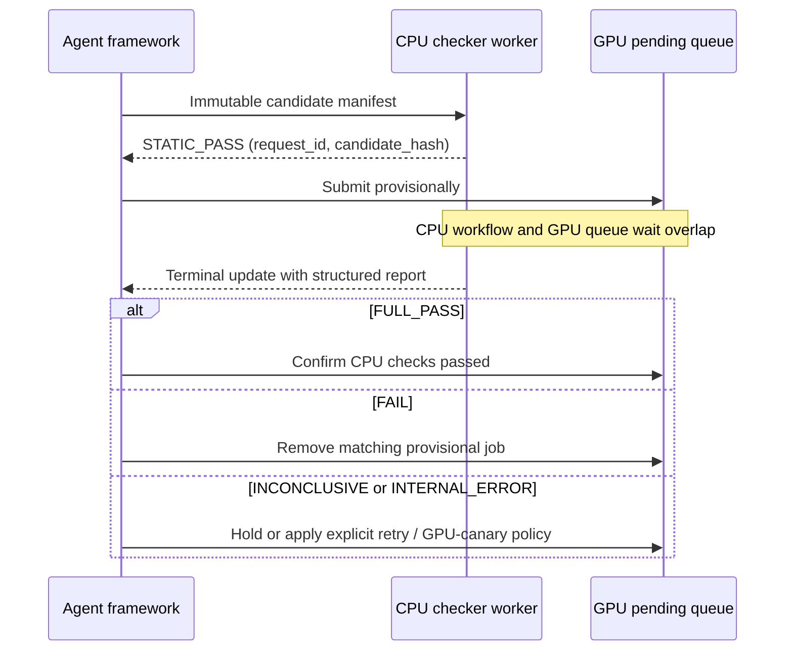

# Agent and scheduler integration

Keep framework-specific translation outside this repository:

1. Materialize the generated candidate and a tiny task fixture.
2. Supply an explicit adapter and v1 manifest.
3. Invoke the CLI in the CPU container and persist the JSON report with node metadata.
4. Send confirmed diagnostics to the review agent and rerun after repair.
5. Limit repair attempts.
6. Admit `PASS`, reject `FAIL`, and handle `INCONCLUSIVE` according to policy with
   `GPU_CHECK_REQUIRED`.
7. Treat `INTERNAL_ERROR` as checker infrastructure failure, never model blame.
8. Run a target-GPU canary inside the eventual full allocation before expensive setup, then
   continue training in that allocation.

Pin a released commit as a submodule only after replaying the organization's historical corpus
and measuring catch rate, false hard rejection, inconclusive rate, latency, and peak CPU memory.

## Speculative admission

The integration boundary is a **candidate manifest → structured diagnostic report**. Deploy
the package in CPU container workers for generated code; use the Python package directly only
for trusted local candidates. Framework-specific GPU submission and cancellation stay outside
the checker, so the CPU container needs neither scheduler credentials nor network access.



Only the inexpensive source stage runs before `STATIC_PASS`. Original-width construction,
data contracts, abstract scenarios, CPU training, validation, hardware checks, and memory
estimates still run before a final report. Hidden-width reduction retains all its original
prerequisites, and configured scenario concurrency remains available. Speculative mode always
bypasses the report cache and does not accept `--only`.

### CPU container worker

Build the existing CPU image, then launch one worker per candidate:

```bash
docker build -f docker/Dockerfile.cpu -t model-preflight:cpu .
docker run --rm --init --network none --read-only --cap-drop ALL \
  --security-opt no-new-privileges --pids-limit 128 --cpus 4 --memory 4g \
  --tmpfs /tmp:rw,noexec,nosuid,size=1g \
  --mount type=bind,src="$PWD/examples/image_classification",dst=/work,readonly \
  model-preflight:cpu check /work/preflight.yaml --format events
```

The image runs as a non-root user. No GPU is exposed. Prepare an image with any candidate
dependencies installed before execution; network access is disabled at runtime. Size container
limits for the manifest's worker/thread settings and memory budget. Keep candidate code,
fixtures, and manifest in an immutable per-submission directory and mount it read-only. Place
output files outside those input directories.

Launch this command with the framework's subprocess/job manager and consume stdout line by
line. Do not use a blocking `subprocess.run()` or wait for container exit before reading.
The worker remains alive after its first flushed line; background execution is relative to
the framework. Persist the event stream and track the container until its terminal event.
Prebuilt images avoid rebuilding dependencies per submission; container startup and controller
imports still contribute to first-response latency.

Each JSON line has `event_schema_version: 1`, a unique `request_id`, `candidate_id`,
`candidate_hash`, `fixture_hash`, `manifest_hash`, increasing `sequence`, `status`, `terminal`,
`speculative_submission_allowed`, `gpu_check_required`, `static_result`, `report`, and `error`.
The initial event has sequence 1. A provisional pass has `report: null`, `terminal: false`,
and `gpu_check_required: true`. Its final update has sequence 2 and the existing schema-v1
report; a controller error or changed-input result can instead have `report: null` and a
structured `error`. Static rejection emits just one terminal event and starts no CPU workers.
Invalid manifests/profiles exit 30 without a provisional event.

| Status | Terminal | Framework action |
|---|---|---|
| `STATIC_PASS` | No | May enter the speculative pending queue; retain request identity. |
| `FULL_PASS` | Yes | Configured CPU workflow passed; honor the report's `gpu_check_required`. |
| `FAIL` | Yes | Candidate defect confirmed; remove the matching speculative job under rejection policy. |
| `INCONCLUSIVE` | Yes | Hold, retry, or require a GPU check under explicit policy; not a confirmed defect. |
| `INTERNAL_ERROR` | Yes | Checker infrastructure failed; retry unchanged inputs, not candidate repair. |

Final reports retain `overall_status: PASS` for a successful workflow; `FULL_PASS` is an
integration-event status, not a report-schema change. Normal report exit codes still apply.
`--report` and `--junit` can persist a report when one exists. Existing blocking `check()`,
CLI text/JSON output, and the separate Lightning source/probe interface retain their behavior.

Map **request ID → exact scheduler job ID and candidate hash**, not just candidate name.
Process updates idempotently by `(request_id, sequence)`; ignore duplicates and stale updates
from an earlier revision. A late failure must never cancel a newer replacement job. A worker
exit, transport loss, timeout, or missing terminal event is unresolved verification, never
`FULL_PASS`. The framework owns watchdogs, reconnect/persistence, and scheduler actions.

If GPU capacity becomes available before verification completes, the framework must explicitly
choose to hold expensive training or accept speculative execution and later cancellation. A
pending-queue wait at least as long as the background check hides its latency; shorter waits
hide only the overlapping portion. This changes time on the critical path, not checking work
or GPU assurance. Keep the target-GPU canary even after `FULL_PASS`.

### Trusted local Python use

```python
from model_preflight import submit

submission = submit("preflight.yaml")  # returns after static checks
first = submission.initial.to_dict()
if first["status"] == "STATIC_PASS":
    # Record request_id -> your provisional scheduler job ID here.
    # The complete workflow is already running in isolated subprocesses.
    pass

# Continue framework work; poll() does not wait.
current = submission.poll().to_dict()

# Wait only where the framework actually needs the final decision.
final = submission.completion.result().to_dict()
# FULL_PASS -> confirm; FAIL -> remove matching job; other statuses -> policy/retry.
```

`completion` is a standard [`concurrent.futures.Future`](https://docs.python.org/3/library/concurrent.futures.html), so the framework can attach a done
callback or use `asyncio.wrap_future()` instead of polling. Keep the owner process alive until
completion; this API is not a detached durable service. Python waits for these background
threads during orderly interpreter shutdown. Bound concurrent submissions in the framework in
addition to each manifest's `max_workers`/`cpu_threads` limits.

Candidate, fixture, and manifest changes observed before or after the workflow produce
`INCONCLUSIVE` with `INPUT_CHANGED`, without promoting an obsolete report. These boundary
checks do not replace immutable snapshots: a read-only container mount does not stop a host
process from editing its backing files, and external dependencies are not snapshotted.

### Verification

Focused regression coverage can be rerun with:

```bash
python -m pytest -q tests/unit/test_speculative.py tests/integration/test_speculative_cli.py
```

The 2026-10-16 smoke experiment exercised a valid wide MLP, detached loss, syntax rejection,
and forced worker timeouts, both locally and in the restricted CPU container above. All eight
runs produced their expected event sequence and simulated queue outcome: confirm, remove,
never submit, and hold, respectively. The valid model reduced all three CPU workflow scenarios.

| Wide MLP, one run | First `STATIC_PASS` | Terminal `FULL_PASS` | Background interval |
|---|---:|---:|---:|
| Local CLI | 0.090 s | 7.086 s | 6.995 s |
| CPU container | 0.439 s | 8.105 s | 7.667 s |

These are smoke measurements, including startup, not a statistically established speedup.
No real GPU scheduler was contacted. Local Python used PyTorch 2.11.0; the CPU image used
Python 3.11.17 / PyTorch 2.14.1+cpu, so the rows are not a controlled environment comparison.
Frozen inputs/source, image identity, raw event streams, final reports, exact commands, and the
measurement script are retained locally in `.cache/speculative-integration-20261016/`.

