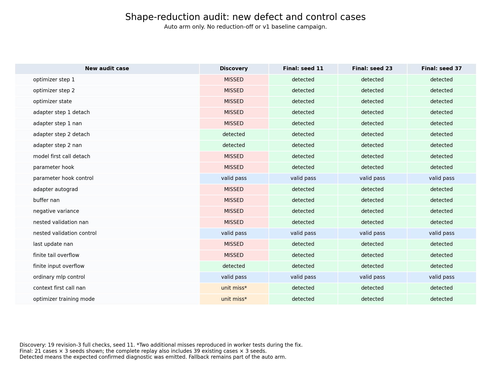

# Shape-reduction adversarial audit

For release scope and availability of raw artifacts, see the [paper-release guide](paper-release.md).

This follow-up tests defect detection with **automatic reduction only**. No reduction-off
or v1 baseline arm is run. Original-width execution still occurs when the checker falls
back or confirms a reduced failure; that is part of the auto arm's normal behavior.

The corpus adds 21 cases: 18 explicit defects and three valid controls. Together with the
existing 39 synthetic cases, the final replay scope is 60 cases across seeds 11, 23, and 37.
Expected status and diagnostic codes are frozen before each replay. Archived candidates and
timing comparisons are excluded from this follow-up.

## Final results

All **180 runs matched their frozen labels**, including their expected confirmed diagnostic
codes. The auto-only label gate passed. No baseline-relative quality or performance gate was
re-evaluated.

| Scope | Cases | Runs | Defect detections | False hard rejections | Checker errors |
|---|---:|---:|---:|---:|---:|
| New audit | 21 | 63 | 54 / 54 | 0 | 0 |
| Existing synthetic corpus | 39 | 117 | 69 / 69 | 0 | 0 |
| Complete replay | 60 | 180 | **123 / 123** | **0** | **0** |

There were 54 successful valid-model runs and three expected `INCONCLUSIVE` runs for
dynamic control flow. All eight existing architecture controls reduced all three CPU
scenarios at every seed: **72 / 72 scenarios**. The new ordinary-MLP and nested-validation
controls also reduced; the identity-hook control correctly used original width.

Across the complete corpus, reduction applied in 135 of 450 eligible scenario attempts;
27 original-width confirmation retries were retained. Risky cases intentionally fall back.
Every report passed JSON-schema validation. Independent checks verified 60 frozen source
hashes, 177 applicable original-model memory estimates, and 450 original parameter counts.



[SVG figure](figures/audit.svg) ·
[PDF figure](figures/audit.pdf) ·
[Case results](../.cache/shape-reduction-audit-final/case-results.csv) ·
[Evidence verification](../.cache/shape-reduction-audit-final/verification/evidence.json)

The implementation passed **90 tests**, mypy over 47 source files, changed-file Ruff, and
sdist/wheel builds. Full-repository Ruff still reports the pre-existing `E501` at
`src/model_preflight/checks/source/ast_checker.py:357`. Logs and checks are saved under
[verification](../.cache/shape-reduction-audit-final/verification/checks.json).

## Discovery and fixes

The initial revision-3 discovery pass ran 19 newly labeled cases with seed 11. It detected
three of 16 defects and missed 13; all three valid controls passed. The two additional
lifecycle cases were reproduced as failing worker regression tests while reviewing the fix.
Their pre-fix logs are retained separately, not counted as full discovery reports.

| Defect mechanism | Initial evidence | Revision-4 handling |
|---|---|---|
| Width-dependent optimizer exceptions on steps 1 and 2 | Two missed defects | Custom optimizer implementations use original width |
| Preloaded momentum corrupts a discarded channel | Missed | Preloaded optimizer state uses original width |
| First adapter call detaches loss or produces NaN | Two missed defects | Independent probe objects preserve the first call; configured calls are compared |
| First model call detaches output | Missed | Shape tracing starts from an unused model snapshot |
| Parameter gradient hook is lost when parameters are replaced | Missed | Parameter and post-accumulation hooks prevent reduction |
| Adapter-local custom backward fails only at original width | Missed | Explicit custom autograd in workflow methods prevents reduction |
| Tail BatchNorm mean is NaN or variance is negative | Two missed defects | Original buffers and variance domain are checked before slicing |
| Validation returns NaN inside a tensor container | Missed | Nested dictionaries, lists, and tuples are checked recursively |
| Final optimizer update corrupts parameters | Missed | Parameters and optimizer state are checked after every update |
| Finite tail weights overflow ordinary linear arithmetic | Missed | Extreme original values prevent reduction |
| Context counter hides the first failing call | Additional worker reproducer | Probe contexts/scenarios are isolated; mutated contexts prevent reduction |
| Optimizer observes the wrong initial train/eval mode | Additional worker reproducer | Probe construction follows the actual optimizer, batch, then mode-switch ordering |

Already-detected controls cover second-call detached/NaN losses and large-input overflow.
Valid controls cover an identity gradient hook, nested finite validation output, and an
ordinary MLP. The eight existing performance models remain in the quality replay to verify
actual reduction on supported workloads.

Nested validation and post-update checks close general CPU-checker gaps, not exclusively
shrink-induced gaps. They apply with reduction disabled too. Existing diagnostic identifiers
are retained: `NUM001` for nonfinite values, `NUM002` for gradients, and `AUT001`/`AUT002`
for gradient-flow or execution failures. Fallback is not itself a candidate rejection.

## Evidence and reproduction

- Discovery: [frozen revision-3 reports](../.cache/shape-reduction-audit-r3/summary.json),
  with 19 auto-only runs and immutable candidate sources.
- Lifecycle reproducers: [mode-order test](../.cache/shape-reduction-probe-order-before.log)
  and [context-mutation test](../.cache/shape-reduction-context-before.log).
- Final replay: [summary](../.cache/shape-reduction-audit-final/summary.json),
  [measurements](../.cache/shape-reduction-audit-final/measurements.csv), and
  [per-case/category breakdown](../.cache/shape-reduction-audit-final/breakdown.csv).

Each experiment directory contains source snapshots, labeled corpus, configured manifests,
seeded reports, worker evidence, controller logs, host-load samples, and checker source hash.
Earlier focused revision-4 probes are retained separately and are not pooled into the final
replay. Their exclusions are recorded in
[the verification receipt](../.cache/shape-reduction-audit-final/verification/excluded-intermediate-runs.json).
The final summary has `complete: true` and `label_gate: true`. Its checker source SHA-256 is
`8098a54462c291d5f393b4ebd95eacbcae4b1b15d71013cd22eb8b6c729e0882`.

From the repository root, using the `model-preflight` Python environment:

```bash
PYTHONPATH=src:. python scripts/run_shape_reduction_experiment.py freeze \
  --auto-only --output .cache/shape-reduction-audit-replay
PYTHONPATH=src:. python scripts/run_shape_reduction_experiment.py run \
  --output .cache/shape-reduction-audit-replay
PYTHONPATH=src:. python scripts/run_shape_reduction_experiment.py summarize \
  --output .cache/shape-reduction-audit-replay
OMP_NUM_THREADS=1 MKL_NUM_THREADS=1 PYTHONPATH=src:. python -m pytest -q
```

The retained artifact's `analyze.py` independently verifies the completed reports and emits
`case-results.csv`. Run it with `--plot` in an environment containing Matplotlib to regenerate
the figure; this run used `/home/justin/miniconda3/envs/perfseer/bin/python` for plotting only.

Runs are sequential, caching is disabled, workers use one CPU thread, and CUDA is hidden.
This is a shared WSL host; unrelated workloads are preserved. This audit does not establish
a new speedup estimate or baseline-relative parity. Those acceptance gates remain `null`;
`label_gate` checks complete coverage, expected outcomes/codes, checker errors, and actual
reduction in supported controls.

## Limits

The fixes establish coverage for these labeled defects, not numerical equivalence for all
models. Floating-point accumulation, cancellation, underflow, parameter-value-dependent
branches after updates, longer training histories, external/global state, or unrecognized
custom backward behavior can still differ after shrinking. Full-width numerical validation
remains required; reduction stays opt-in and defaults to `off`.
The existing workflow covers its configured one/two training steps and separate fresh-model
validation. Longer training histories and validation on updated training state need additional
workflow scenarios.

The extreme-value threshold is a conservative reason to fall back, not a bound proving
safe arithmetic. Copying probes, scanning original tensors/batches, and checking updates
adds work. Revision-3 performance measurements do not measure this revision's overhead.
