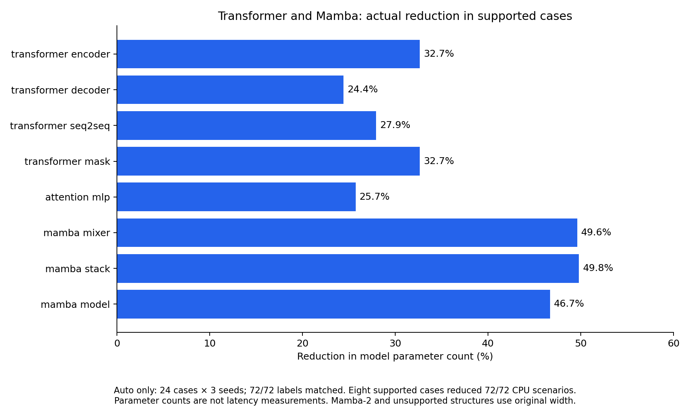

# Experimental hidden-width reduction

For release scope and availability of raw artifacts, see the [paper-release guide](paper-release.md).

Shape reduction is opt-in. It preserves original-size source, hardware, construction,
data-contract, and abstract checks, then attempts a smaller model for the existing CPU
training and validation stages. The memory estimate always describes the original model.

The [initial revision-2 comparison](shape-reduction-experiment.md) failed both the quality and
performance gates: reduction hid one numerical defect and increased median end-to-end time.
Revision 3 keeps workflows with explicit overflow- or singularity-sensitive math at original
width, including exponential, logarithm, power, division, and root operations. This fixes the
observed overflow miss through fallback; it does not prove numerical equivalence for arbitrary
workflows. The disabled default is retained.

The [revision-3 follow-up](shape-reduction-followup.md) confirms the fix across the original
three seeds and measures width scaling: larger CNN/residual workloads accelerate, while
image/tabular workloads remain slower end to end.

Revision 4 adds an [auto-only adversarial audit](shape-reduction-audit.md). It isolates probe
state, preserves optimizer/batch/train-mode ordering, compares configured training calls, and
falls back for mutable workflow contexts, parameter hooks, custom backward/update code,
preloaded optimizer state, invalid normalization buffers, and extreme numerical inputs.
CPU checks now also inspect nested validation tensors and parameters/optimizer state after
each update, including the last step. These two numerical checks apply with reduction off too.

```yaml
execution:
  shape_reduction:
    mode: auto
    width_factor: 0.5
    minimum_width: 16
  seed: 11
```

The default mode is `off`. The factor must be strictly between zero and one. The minimum
must be a positive multiple of eight, at least eight. Target hidden widths are rounded down
to multiples of eight and never enlarged. A seed is optional; when provided it initializes
Python, PyTorch, NumPy when installed, and the worker's Python hash seed.

Reduction requires selected source checks with no confirmed failure, plus successful
original-model construction, data-contract, and every abstract scenario. A partial run such
as `--only cpu_training` uses original widths. Unsupported models also use original widths.

The worker uses FX to couple linear and ungrouped Conv1d/Conv2d feature dimensions with
normalization and residual connections. Inputs, outputs, and concatenation boundaries are
fixed. Supported pooling and flatten operations propagate channel dimensions. Width changes
retain the original candidate methods, parameter names, gradient requirements, sliced
parameter values, optimizer configuration, and all batch/precision/step settings. Layer count,
input resolution, sequence length, and output classes remain unchanged.

Before applying changes, the worker checks disposable meta models, training and validation
operation graphs, output contracts, required gradients, and optimizer groups. Unknown
operations, custom autograd, ambiguous shapes, shared parameters, and untraceable paths fall
back to the original model. Cached models or probes sharing modules with the real model are
also rejected before probe execution. Model construction still allocates original CPU parameters before
slicing; this feature does not eliminate construction cost or guarantee lower peak memory.

A reduced execution failure receives one original-width retry in a fresh worker. Only that
original result can establish a candidate failure. Each attempt retains its normal worker
timeout, so a retry can double the scenario's wall-time allowance. Both results and their
combined duration appear in the report. Timeouts and infrastructure failures retain existing
classification rules.

Stage evidence contains `shape_reduction`, including whether reduction was applied, the
original and reduced parameter counts, changed dimensions, duration, and fallback reason.
Workers also report execution time and peak RSS. Successful reduced checks set
`gpu_check_required`: they establish reduced-width workflow behavior, while original-width
numerical behavior still requires validation. Full-size abstract checks cannot prove numeric
stability; even unchanged operator graphs can behave differently at smaller widths.

The numerical range guard scans original parameters, buffers, and disposable CPU batches.
Floating-point magnitudes above `sqrt(torch.finfo(dtype).max)` cause original-width fallback;
negative BatchNorm running variances do too. This threshold is conservative, not a proof
against overflow, underflow, or cancellation. Batch probes preserve RNG state and use copied
adapter/scenario objects. These guards and additional meta probes add overhead; previous
revision-3 timing results do not measure revisions 4 or 5.

## Transformer and Mamba coverage

Reducer revision 5 extends the existing FX planner with explicit dimension rules for known
library structures. It does not rebuild a different architecture or replace candidate methods.

| Structure | Reduced dimensions | Preserved dimensions / fallback |
|---|---|---|
| PyTorch `TransformerEncoderLayer`, `TransformerDecoderLayer`, encoder/decoder stacks, `Transformer` | Each feed-forward expansion (`linear1` output and `linear2` input) | Model width, attention projections, heads, normalization, depth, masks, sequence length |
| `MultiheadAttention` and `Embedding` | Adjacent supported MLP expansions may shrink | Attention and embedding dimensions are fixed boundaries |
| Hugging Face Mamba-1 `MambaMixer`, `MambaBlock`, `MambaModel` | Internal expansion channels, paired signal/gate projections, depthwise channels, state parameter rows, output projection columns | Hidden size, state size, time-step rank, convolution kernel, sequence length, vocabulary |
| Mamba-2, native `mamba_ssm`, alternative scan backends, cached Mamba inference | None | Whole model stays at original size |
| Unsupported layers, subclasses, custom activation/update/backward paths, uncertain graphs | None | Whole model stays at original size |

Mamba reduction supports the Hugging Face sequential CPU implementation, with
`use_mambapy=False`, `use_associative_scan=False`, and no inference cache. Cache creation in
validation also causes fallback. The checker does not silently change backend or cache settings.
The optional `transformers` package is only needed by candidates that use it; no package
dependency was added. Tested versions are PyTorch 2.11.0 and Transformers 5.7.0. Other versions
must satisfy the same layout checks and disposable-model probes, or use original size.

Mamba's packed input projection must slice corresponding rows from **both** signal and gate
halves. The reducer also couples the convolution, `x_proj`, `dt_proj`, `A_log`, `D`, and output
projection. Parameter metadata and trainability are retained. A scan of the original transition
parameters prevents slicing away exponential overflow. These rules follow the
[Hugging Face Mamba implementation](https://huggingface.co/docs/transformers/model_doc/mamba);
the [native Mamba-2 layout and fused paths](https://github.com/state-spaces/mamba/blob/main/mamba_ssm/modules/mamba2.py)
require separate reduction rules and remain unsupported for shrinking.

Known library blocks are opaque FX boundaries with checked internal layouts; the surrounding
candidate training/validation graphs and configured calls are still compared before and after
reduction. Actual original and reduced library methods execute on disposable meta inputs before
real parameters change. Custom methods, hooks, unexpected children, and unsupported operations
cancel the entire plan. Previously collected changes are not partially applied. A reduced
runtime failure still receives the existing fresh-worker, original-width confirmation retry.
Calling a structured block's internal projection separately, or directly reading its parameters
elsewhere in the workflow, also cancels reduction. This prevents a generic width plan from
overwriting Mamba's packed signal/gate slices. A regression test reproduced this overlap before
the guard was added; its log is retained with the final replay evidence.

Full-size fallback means the checker can continue testing a broader range of structures than
it can shrink. It does not supply missing dependencies or make CUDA-only operations executable
on CPU. Nor does matching operation structure prove numerical equivalence at every width.
Attention-dominated workloads may gain little from shrinking only their feed-forward layers.

The architecture replay freezes the new cases plus existing unsupported-model controls, then
runs seeds 11, 23, and 37 with `auto` only. It includes masks, full Mamba backbones, packed gates,
width-dependent detachment, discarded-channel NaNs, transition overflow, custom Transformer
layers/activations, Mamba caches, and unsupported scan backends. Native `mamba_ssm` is explicitly
excluded when unavailable; its CPU outcome has no asserted defect label. Missing packages and
installed dependency versions are recorded in the frozen corpus. No baseline or timing
comparison is required for this replay.

The completed revision-5 replay contains **24 cases × 3 seeds = 72 reports**, all matching
their frozen labels and expected diagnostic codes:

| Scope | Runs | Valid PASS | Detected defects | Expected INCONCLUSIVE |
|---|---:|---:|---:|---:|
| 19 new architecture cases | 57 | 42 | 15 / 15 | 0 |
| Five existing unsupported-model controls | 15 | 12 | 0 / 0 | 3 |
| Total | **72** | **54** | **15 / 15** | **3** |

There were zero false hard rejections, checker errors, or fallback-policy violations.
All eight supported architecture cases reduced **72 / 72 CPU scenarios** across the three
seeds. The remaining 135 eligible scenarios used original widths; no reduced failure needed
an original-width confirmation retry. The three expected inconclusive reports are the existing
dynamic-control-flow control. The selected corpus's auto-only label gate passed. Baseline-relative
quality and performance gates remain unevaluated, and reduction remains disabled by default.

All 72 reports passed schema validation. Independent checks verified 24 candidate source
hashes, 72 original-model memory estimates, and 207 original parameter counts. The checker
source hash is `b01148d6ede19488a62d98ee929ae1194819aea1e7d8e8746112c065a1d5b713`.
The full suite passed **124 tests**, with one optional `mamba_ssm` test skipped; mypy,
changed-file Ruff, and sdist/wheel builds passed. Full-repository Ruff still reports the
pre-existing `E501` in `checks/source/ast_checker.py:357`.



[Raw reports and frozen sources](../.cache/shape-reduction-architectures-r5-final/) ·
[Summary JSON](../.cache/shape-reduction-architectures-r5-final/summary.json) ·
[Per-case CSV](../.cache/shape-reduction-architectures-r5-final/case-results.csv) ·
[Evidence verification](../.cache/shape-reduction-architectures-r5-final/verification/evidence.json) ·
[SVG](figures/architecture-reduction.svg) ·
[PDF](figures/architecture-reduction.pdf)

The figure measures parameter counts, not speedup. End-to-end median/P95 latency was
8.06/17.97 seconds in this selected corpus, without a comparison arm. Routine verification
and unrelated host workloads were active; recorded one-minute host load ranged from 0.60 to
1.54. These times do not establish acceleration. An earlier pilot was stopped after finding
the projection-reuse issue and is explicitly excluded from the final measurements.

```bash
PYTHONPATH=src:.:scripts python - <<'PY'
from pathlib import Path
from run_shape_reduction_experiment import freeze, run, summarize
from shape_reduction_corpus import cases

output = Path('.cache/shape-reduction-architectures-r5-final').resolve()
selected = {case['name'] for case in cases()
            if case['group'] in {'architecture', 'unsupported'}}
freeze(output, None, auto_only=True, selected=selected)
run(output, ['quality'], None)
summarize(output, False)
PY
```

Use a new output directory for each freeze; existing measurements resume with the normal
`run --output ...` command. `--cases` also selects a corpus at freeze time. A label gate for
this selected corpus describes only that corpus, not a repeat of the earlier full replay.

## Reproducing the comparison

Run from the repository root with its `model-preflight` environment. The harness needs the
repository's tests for the existing mutation sources; no additional runtime dependency is
required for measurements. Plot generation uses an environment with Matplotlib installed.

```bash
PYTHONPATH=src:. python scripts/run_shape_reduction_experiment.py freeze \
  --output .cache/shape-reduction-v2/experiment \
  --archive-root /home/justin/MLEvolve/records/2026-09-14_petfinder_workflow_matrix_final
PYTHONPATH=src:. python scripts/run_shape_reduction_experiment.py run \
  --output .cache/shape-reduction-v2/experiment
PYTHONPATH=src:. python scripts/run_shape_reduction_experiment.py summarize \
  --output .cache/shape-reduction-v2/experiment --plots
```

Freeze records sources, labels, seeds, thresholds, checker hashes, and the current Git HEAD
as the v1 reference. Use the original v1 commit when establishing the initial comparison.
Measurements resume only when the implementation and frozen candidate hashes match. Keep the
output directory: it contains every manifest, source snapshot, report, controller log, timing
receipt, aggregate JSON/CSV, and optional PNG/SVG/PDF plots. Smoke subsets are allowed but
cannot satisfy the final completeness gate.

For a quality audit without any baseline execution, freeze with `--auto-only` and then run
normally. That frozen setting forces only the `auto` quality arm and its three seeds, even
if the default phases include reference/timing. The summary reports label mismatches and
`label_gate`; baseline-relative quality and performance gates remain unevaluated (`null`).

The experiment compares v1 with reduction-off outcomes, then uses three fixed seeds for
paired quality checks and five paired repetitions for eight valid performance models.
Historical snapshots are deduplicated and matched to immutable report hashes. Historical
observations are reported separately from independently labeled synthetic defects. Their
fixture provenance is recorded; replaying an archived synthetic fixture is not real-data
validation.

For a separate width-only size study, freeze with `--scale-study` and run with
`--phases timing`. It retains the previous largest model of each family as an anchor and adds
two larger widths, keeping inputs, batches, depth, and step counts fixed. This timing-only study
does not re-evaluate the original acceptance gates; its summary marks those gates as unevaluated.

The quality gate requires no additional missed labeled defects, false hard rejections, or
checker errors. The performance gate requires at least 1.25x median end-to-end speedup on
the eight performance cases, actual reduction on every supported case, and at most 1.10x
aggregate P95 latency. Gates are measured outcomes; automatic reduction remains opt-in.
